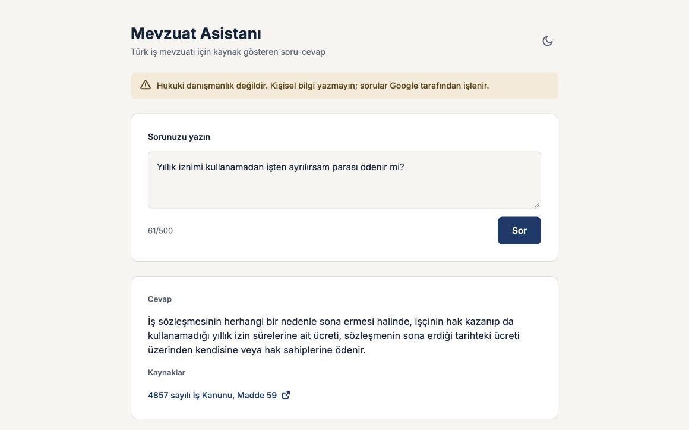

# Mevzuat Asistanı

A RAG system that answers Turkish labour-law questions in Turkish, cites the articles it used, and refuses when the law text does not contain the answer. Its quality is measured on a held-out test set.

> Not legal advice. This is a portfolio project, not a legal service.

## Demo

**Live:** [mevzuat-asistani.netlify.app](https://mevzuat-asistani.netlify.app)

The API runs on a free server that sleeps when idle, so the first question can take about a minute.



## Results

Measured once on a held-out test set of 47 questions, after the system was frozen at commit `17e1215`. The full output is in [`eval/results/20261101-011225-test-final.json`](eval/results/20261101-011225-test-final.json).

| Metric | Result | 95% interval* |
| --- | ---: | ---: |
| Complete and correct answers, graded by hand (35 answerable questions) | **24/35** | 0.51-0.83 |
| Answers containing wrong information, graded by hand (47 questions) | **0** | - |
| Correct refusals on out-of-scope questions | **12/12** | 0.74-1.00 |
| Unnecessary refusals on answerable questions | 7/35 | - |
| Fact accuracy, automatic phrase check | 0.714 | - |
| Citation recall | 0.748 | - |
| Recall@8 | 0.957 | - |
| MRR | 0.905 | - |

\* Clopper-Pearson intervals. The sample is small, so treat these numbers as estimates.

**What the results mean:**

- The system did not invent answers on this test set, which was the main goal.
- It is too cautious. Seven of the 11 incomplete answers were unnecessary refusals, and in four of those the expected article was ranked first.
- Colloquial questions are the weak spot: only 2 of 11 answerable questions written in everyday language were answered completely, compared with 22 of 24 for the other categories.
- Development scores were higher (fact accuracy 0.964 on 33 questions) because the prompt was tuned on those questions and the test questions are harder.

**Limitations of the evaluation:**

- Answers were graded by Claude against the law text, not by a lawyer. Some question labels need legal review.
- Of the 80 questions, 30 were written by the project owner without reading the law; Claude wrote the other 50 and all the answer keys.
- Answers are not fully repeatable. Even at `temperature=0`, one question answered during the final run was refused in a later manual trial, so results can vary between runs.
- The free Gemini tier limited model comparison, so no stronger answer model was evaluated.

### Retrieval comparison

Development split, 27 answerable questions at the time of the comparison, whole articles against split articles:

| Method | Recall@3 | Recall@5 | Recall@8 | MRR |
| --- | ---: | ---: | ---: | ---: |
| **Dense, whole articles (used)** | **0.981** | **0.981** | **1.000** | **0.963** |
| Dense, split articles | 0.981 | 0.981 | 1.000 | 0.926 |
| Hybrid (RRF), whole articles | 0.815 | 0.852 | 0.926 | 0.852 |
| Hybrid (RRF), split articles | 0.815 | 0.889 | 0.926 | 0.850 |
| BM25, whole articles | 0.648 | 0.778 | 0.778 | 0.621 |
| BM25, split articles | 0.685 | 0.796 | 0.815 | 0.615 |

The BM25 implementation is deliberately simple (first five letters as a stem) and this split had no article-number questions, so this does not show that hybrid search is worse in general.

## Features

- Answers only from retrieved articles and states which parts of a question the text does not cover
- Rejects any answer with no citation or with a citation outside the retrieved articles
- Flags repealed articles instead of describing what they used to say
- Separates development and test questions, with the test split locked behind a flag
- Limits requests per visitor and per day to protect the API quota

## How It Works

1. **Ingest:** official PDFs are downloaded from the Turkish legislation portal. Footnotes are removed by font size and the text is split into one chunk per article.
2. **Index:** each of the 138 chunks is embedded with Gemini and stored in local Qdrant.
3. **Retrieve:** the question is embedded and the eight closest articles are retrieved.
4. **Answer:** Gemini returns structured JSON listing the parts of the question, which ones are supported, the answer and the cited articles.
5. **Verify:** code checks the citations and writes the source list itself.

**Corpus:** Labour Law No. 4857 and Article 14 of Law No. 1475 (severance pay), the only article of that law still in force. Severance amounts and other laws are out of scope. The texts were checked on 1 November 2026 and are not stored in this repository.

## Tech Stack

- **Backend:** Python, FastAPI
- **RAG:** Gemini (`gemini-embedding-2`, `gemini-3.5-flash-lite`), Qdrant in local mode
- **Frontend:** Vue 3, TypeScript, Vite
- **Testing:** pytest, a custom evaluation runner

## Getting Started

**Requirements:** Python 3.12+ (tested on 3.13), Node.js 22, and a [Gemini API key](https://ai.google.dev/aistudio).

```bash
git clone <repository-url>
cd mevzuat-rag

python3 -m venv .venv
source .venv/bin/activate
pip install -r requirements-dev.txt

cp .env.example .env   # then set GEMINI_API_KEY
```

Build the data. The second command makes 138 embedding requests.

```bash
python -m mevzuat_rag.chunking
python -m mevzuat_rag.index
```

Run the API and the interface in two terminals, then open <http://localhost:5173>:

```bash
python -m uvicorn mevzuat_rag.api:app --port 8000
```

```bash
cd frontend
npm ci
npm run dev
```

Run the tests and the development evaluation:

```bash
python -m pytest
python -m eval.run_eval
```

## Project Structure

```text
mevzuat-rag/
├── mevzuat_rag/          # Ingestion, retrieval, answering and the API
├── eval/
│   ├── questions.jsonl   # 80 questions with dev and test splits
│   ├── run_eval.py       # Quality metrics
│   ├── compare_retrieval.py
│   └── results/          # Recorded measurements
├── tests/                # API tests
└── frontend/             # Vue interface
```

## What I Learned

- Measuring with realistic questions changes the picture: fact accuracy was 1.0 on questions written from the law text but 0.5 on the first set of everyday questions.
- Automatic checks can pass a wrong answer, so model output also needs to be read by hand.
- Keeping a separate test split shows how much of a development score comes from tuning.
- The source data shapes the system: a parsing bug hid one article, and the main severance rule turned out to be in an older law.

## License

All rights reserved. No license is granted to use, copy, modify or distribute this code. Law texts belong to their official sources and are not distributed here.
